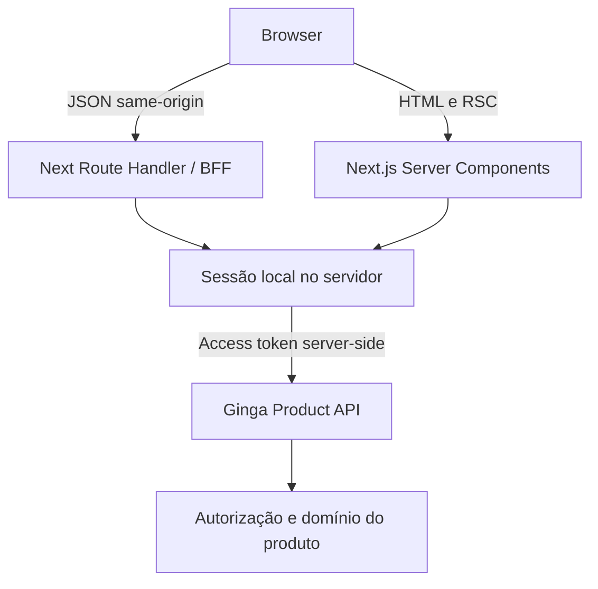

# Arquitetura

Um Core Next.js e três perfis definidos em `template.config.json`. O perfil padrão é public. `APP_KIND` permite validar os perfis antes de a futura CLI podar os módulos. Não há serviço de feature flags nem três aplicações independentes.



```mermaid
sequenceDiagram
  participant B as Browser
  participant N as Next
  participant I as Ginga Identity
  B->>N: GET /auth/login
  N->>N: state, nonce, verifier e cookie de transação
  N-->>B: Redirect para authorization endpoint do Discovery
  B->>I: Login/consentimento no Identity
  I-->>B: code, state, iss
  B->>N: GET /auth/callback
  N->>I: Token exchange + PKCE + resource
  N->>N: Validar OIDC/JWKS e criar sessão
  N-->>B: Cookie opaco HttpOnly; redirect interno
```

## Organização

- `src/app`: App Router, metadata, páginas e handlers pequenos. Server Components por padrão.
- `src/config`: schema puro testável, configuração server-only, capabilities e navigation.
- `src/components`: composição própria; primitives sempre de `@ginga/ui`.
- `src/lib`: validação compartilhável, HTTP do browser, erros e factory Query.
- `src/server`: OIDC, sessões, HTTP autenticado e proteção CSRF. Todos os módulos marcados `server-only`.
- `src/providers`: providers clientes locais à capability.
- `src/i18n` e `messages/<locale>/<namespace>.json`: Core obrigatório com next-intl, resolução validada, traduções e normalização visual de erros.
- `tests`: unitários, componentes, integração OIDC por boundary e E2E de produção.

## Decisões

Next 16.3.5 tem os patches de segurança de agosto e uma correção de nonce nos scripts de loading/template. React 19.3.0 é a peer dependency do Ginga UI 0.1.4. Apesar de recente, essa versão é exigida pelo contrato do DS; não usamos APIs experimentais de React. Ver [dependências](dependencies.md).

O CSS Tailwind 4.3.3 já foi compilado pelo DS. O consumidor usa CSS semântico para layout e overrides; não instala pipeline Tailwind paralelo. O DS 0.1.4 não exporta AppShell/Sidebar/Breadcrumbs: a composição semântica de sidebar/header/navigation pertence a este boilerplate. Não há breadcrumb fictício para uma navegação de nível único.

Public usa renderização dinâmica para uma CSP com nonce por resposta, assim como os perfis autenticados. Exportação estática/ISR não é um modo suportado desta entrega. Uma futura capability estática exigirá política de hashes/headers no host, testes e uma decisão explícita; não ativar SRI experimental apenas para contornar isso.

Sessões em memória servem a um único processo Node. São perdidas em restart, sem armazenamento de tokens em disco ou cookies. Em produção, `SESSION_SINGLE_PROCESS=true` declara essa topologia. Réplicas, PM2 cluster, serverless e edge exigem primeiro substituir o store e a exclusão mútua de refresh por mecanismo compartilhado. Não basta sticky session.

Não há client-side RBAC, tenant engine, analytics, state manager global ou domínio de exemplo. Password, MFA e políticas de autenticação forte pertencem ao Identity. A organização de `server/auth` permite futura extração de `@ginga/auth-next`, após uso real; nenhum pacote de auth foi criado agora.

## Fronteiras de confiança

Internacionalização é Core, não feature futura. Public usa URLs por locale; app/backoffice usam preferência validada sem alterar callback OIDC. IntlProvider não transforma children Server Components em Client Components. Metadata, forms e estados de erro compartilham os catálogos. Ver [internacionalização](internationalization.md).

Product API → schema ApiErrorResponse → ApiError → tradução por code. x-correlation-id acompanha Browser → BFF → API; erros inválidos/inesperados são normalizados, nunca renderizados como texto técnico. Identity tem adapter próprio. Ver [contrato de erros](error-handling.md).

Browser é não confiável; UI não autoriza. Product API valida o JWT novamente e decide acesso ao domínio. Identity autentica e emite tokens. Configuração, DNS, TLS/ingress e dependências são administrados por operadores confiáveis. Nenhum serviço compartilha o banco ou os cookies do Identity.
